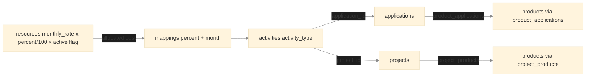

# Workforce Mapper — Database Schema

SQLite, EF Core code-first. Schema created via `dotnet ef migrations add InitialCreate`; applied at startup via `context.Database.Migrate()`. Taxonomy tables seeded via EF Core `HasData()`; resources and mappings seeded from `data/resources.json` and `data/mappings.json` at startup.

> Entity definitions and column names are in `CONTEXT.md` § Data Model.

---

## Cost Attribution Chain

**Cost model:** `allocated_monthly_cost = monthly_rate x (percent / 100)` **only when active flag = 1**. Active flag 0 means cost = 0 for that month regardless of mappings.

---

## Key Constraints

| Table | Constraint |
|---|---|
| `resources` | `resource_id` UNIQUE — stable text identifier e.g. PI00123 |
| `mappings` | Composite PK (resource_id, activity_id, month) |
| `mappings.percent` | Advisory only — no DB CHECK; UI shows red over-allocation indicator. API accepts any value. |
| `product_applications` | Composite PK (product_id, application_id) |
| `project_products` | Composite PK (project_id, product_id) |
| `activities.application_id` | Nullable — null for project activities |
| `activities.project_id` | Nullable — null for application activities |

---

## Reference Counts (seeded from data/taxonomy.json)

| Table | Count | Notes |
|---|---|---|
| applications | 18 | Across 4 divisions |
| products | 7 | 28.9m USD ARR |
| product_applications | 26 | 3-5 dependent applications per product |
| projects | 12 | One per project-change activity |
| project_products | 26 | Several projects benefit multiple products |
| activities | 33 | 10 PE / 9 Analytics / 8 Data Collection / 6 Client Services |
| resources | 80 | Seeded from data/resources.json |
| mappings | ~160 | Seeded from data/mappings.json; updated via UI |
