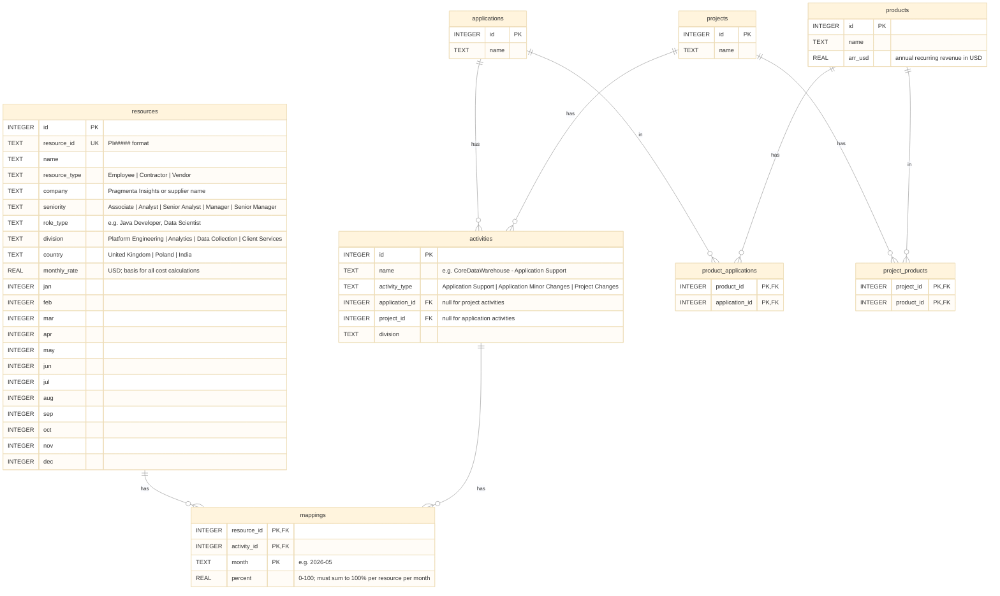
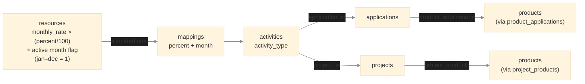

# Workforce Mapper — Database Schema

SQLite database managed by Entity Framework Core (code-first). Schema created via `dotnet ef migrations add InitialCreate`; applied at startup via `context.Database.Migrate()`. Taxonomy tables (applications, products, projects, activities, and their joins) are seeded from `data/taxonomy.json` via EF Core `HasData()`.

---

## Entity Relationship Diagram

---

## Cost Attribution Chain

**Cost model:** `allocated_monthly_cost = monthly_rate × (percent / 100)` **only when the resource's active flag for that month is `1`**. If the active flag is `0` the resource is not billing — all cost figures are `0` for that month regardless of any mappings. Summed across all mappings for a resource, `percent` values must total 100% per month for a fully-allocated resource. The `product_applications` and `project_products` joins enable attribution up to product level, surfaced by the `get_cost_by_product` NL query tool.

---

## Key Constraints

| Table | Constraint |
|---|---|
| `resources` | `resource_id` UNIQUE — stable identifier preserved across re-uploads |
| `mappings` | Composite PK `(resource_id, activity_id, month)` — one mapping per resource/activity/month |
| `mappings.percent` | Advisory 100% rule — no database CHECK constraint; enforced by UI (red over-allocation indicator, unallocated filter). API accepts any value. |
| `product_applications` | Composite PK `(product_id, application_id)` |
| `project_products` | Composite PK `(project_id, product_id)` |
| `activities.application_id` | Nullable — null for project activities |
| `activities.project_id` | Nullable — null for application activities |

---

## Reference Counts (seeded from `taxonomy.json`)

| Table | Count | Notes |
|---|---|---|
| applications | 18 | Across 4 divisions |
| products | 7 | Subset of 14-product portfolio; $28.9m ARR |
| product_applications | 26 | Each product has 3–5 dependent applications |
| projects | 12 | One per project change activity |
| project_products | 26 | Several projects benefit multiple products |
| activities | 33 | 10 PE / 9 Analytics / 8 Data Collection / 6 Client Services |
| resources | 80 | Loaded from `sample-headcount.xlsx` |
| mappings | ~160 | Created via UI or accepted from AI suggestions |
